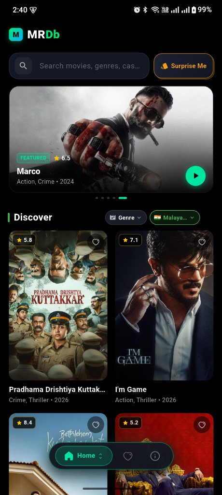
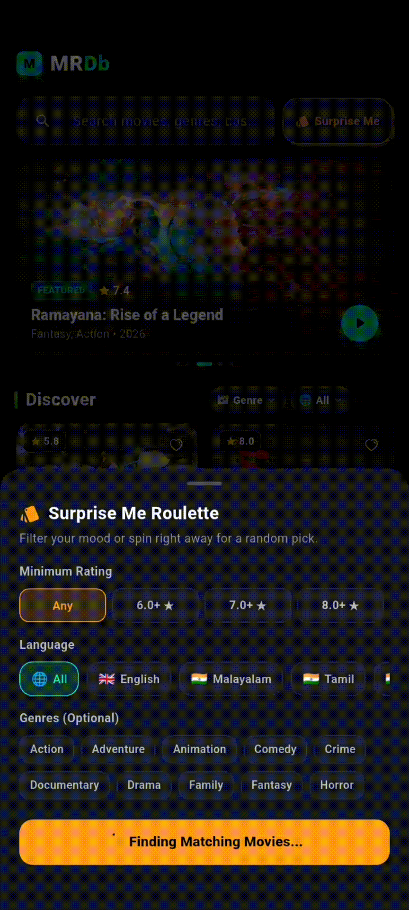
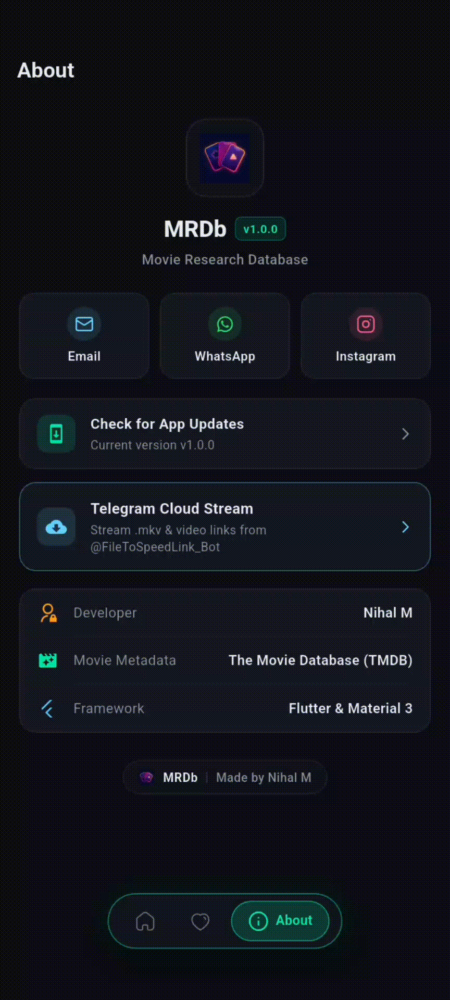

<div align="center">

# 🎬 MRDb — Movie Research Database

**Discover movies, watch trailers & verified soundtracks, and stream HD videos directly in one clean Flutter app.**

[](https://flutter.dev)
[](https://dart.dev)
[](https://www.themoviedb.org/)
[](https://firebase.google.com/)

[⬇️ Download Latest APK](https://github.com/nihhaall/mrdb/releases) · [🤖 Telegram Stream Bot](https://t.me/FileToSpeedLink_Bot)

</div>

---

## ✨ Features

### 🎥 Movie Discovery & Details
- **Smart Search & Browse** — Explore trending, popular, and upcoming movies powered by the TMDb API.
- **Random Movie Picker** — Can't decide what to watch? Spin up a random movie recommendation.
- **Full Movie Insights** — Cast & crew profiles, actor filmographies, genres, ratings, release info, and shareable movie cards.
- **Trailers & Official Songs** — Watch inline trailers and verified movie soundtracks right on the preview page.
- **Favorites Sync** — Save your favorite movies with Firebase Firestore sync.

### ▶️ Built-in Stream & HD Player (`media_kit`)
- **Stream with Unique Code** — Paste any `MRDB-...` code from [@FileToSpeedLink_Bot](https://t.me/FileToSpeedLink_Bot) under **About → Stream** and play immediately.
- **Unified Search** — Search uploaded bot video files and the TMDb movie database from a single bar.
- **Gesture Controls**:
  - **Double-tap Left / Right** — Rewind `-10s` or forward `+10s`.
  - **Long-press & Hold** — Instant `2x` playback speed while holding.
  - **Vertical Swipe Left / Right** — Smoothly adjust screen brightness (left) and media volume (right).
- **Player Options** — Switch video quality (`Original`, `720p`, `480p`, `360p`), audio tracks, embedded subtitles, playback speed, and screen aspect fit.

### 🔄 Smooth Experience
- **Network Awareness** — Clean offline & slow-connection banners with retry actions.
- **In-App Updates** — Checks for new releases and supports seamless APK updates.

---

## 📱 How to Stream Using the Telegram Bot

1. Open [@FileToSpeedLink_Bot](https://t.me/FileToSpeedLink_Bot) on Telegram and send any `.mkv` or `.mp4` video file.
2. Copy the **`MRDB-...` Stream Code** from the bot's reply.
3. Open **MRDb → About → Stream**, paste the code, and tap **Play**.

---

## 🎬 App Demos

<div align="center">
<table>
  <tr>
    <td align="center"><br/><sub><b>🏠 Home & Discover</b></sub></td>
    <td align="center"><br/><sub><b>🎲 Random Movie Picker</b></sub></td>
    <td align="center"><br/><sub><b>▶️ Stream & HD Player</b></sub></td>
  </tr>
</table>
</div>

---

## 🛠️ Tech Stack

| Layer | Technology |
| :--- | :--- |
| **Framework** | Flutter (Dart `^3.8.1`) |
| **Video Player** | `media_kit`, `media_kit_video`, `media_kit_libs_android_video` |
| **Movie & Media APIs** | TMDb API, YouTube Player & Data API |
| **Backend & Sync** | Firebase Core & Cloud Firestore |
| **State & Networking** | Provider, Riverpod, `http`, `dio`, `cached_network_image` |
| **Stream Companion** | [FileToLinkBot](https://github.com/nihalnihu/FileToLinkBot) |

---

## 🚀 Getting Started

```bash
# 1. Clone the repository
git clone https://github.com/nihhaall/mrdb.git
cd mrdb

# 2. Install dependencies
flutter pub get

# 3. Run on a connected device
flutter run

# 4. Build release APK
flutter build apk --release
```

---

<div align="center">
Made with ❤️ by <a href="https://github.com/nihhaall">Nihal</a>
</div>
